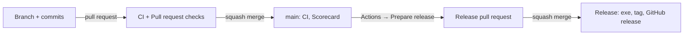

# Workflows

What each GitHub Actions workflow does, when it runs, and what to do when it fails.
The names below are the ones in the Actions tab and in a pull request's checks
(`CI / Lint and checks`). Every workflow file also starts with a comment on what it's
for. GitHub has no description field for workflows.

## The life of a change

1. **Pull request:** `CI` and `Pull request` run. Every job they run must pass
   before you can merge. These are the required checks on `main`. CI's last job,
   `SonarQube Cloud`, analyses the code with the Rust job's coverage and reports on the
   pull request (not on a fork's: its run gets no secrets).
2. **Merge to `main`:** `CI` runs again on the merged state, and so does `Scorecard`.
   `Release` starts too, but it only checks whether the commit is a release and stops
   if it isn't. (Not after a Dependabot auto-merge: GitHub starts no workflows for a
   merge made with the workflow's token. The pull request had passed everything.)
3. **Release:** run `Prepare release` by hand. It opens a release pull request.
   Merging that pull request runs `Release`, which publishes everything. See
   [CONTRIBUTING.md](../../CONTRIBUTING.md#releases-maintainers).
4. **Every Monday:** `Scorecard` and `Links` run, along with Dependabot's update pull
   requests ([dependabot.yaml](../dependabot.yaml)).

## At a glance

| Workflow                | File                                                     | Runs                                   | Purpose                                                                                                                           |
| ----------------------- | -------------------------------------------------------- | -------------------------------------- | --------------------------------------------------------------------------------------------------------------------------------- |
| CI                      | [ci.yaml](ci.yaml)                                       | pull requests, push to `main`, by hand | Lint and checks; Rust lint, docs, tests and build on Windows (oldest and newest Rust); the core on Linux; the crates (cargo-deny) |
| Pull request            | [pull-request.yaml](pull-request.yaml)                   | pull requests (title, new pushes)      | Conventional Commits title (it becomes the changelog line); complete release notes                                                |
| Pull request title help | [pr-title-help.yaml](pr-title-help.yaml)                 | pull requests (opened, title edited)   | A comment that explains a bad title and how to fix it                                                                             |
| Dependabot auto-merge   | [dependabot-auto-merge.yaml](dependabot-auto-merge.yaml) | Dependabot's pull requests             | Auto-merge for safe updates (dev tools and actions, patch and minor) once approved and green                                      |
| Prepare release         | [prepare-release.yaml](prepare-release.yaml)             | by hand                                | Version bump on a `release/vX.Y.Z` branch, opens the release pull request                                                         |
| Release                 | [release.yaml](release.yaml)                             | push to `main`, a `v*.*.*` tag         | `trayward.exe`, tag, GitHub release (only for a release commit)                                                                   |
| Scorecard               | [scorecard.yaml](scorecard.yaml)                         | push to `main`, weekly, by hand        | OpenSSF security rating, README badge (public repository only)                                                                    |
| Links                   | [links.yaml](links.yaml)                                 | weekly, by hand                        | Broken links in the Markdown files (public repository only)                                                                       |
| Fuzzing                 | [fuzz.yaml](fuzz.yaml)                                   | changes to the core, Sundays, by hand  | Random input into the core's parsers (cargo-fuzz): no input may panic                                                             |

## CI

The main quality gate. Locally, `npm run check` runs the same checks.

| Job                          | What it checks                                                                                                                                                                                                                                                                                                         | When it fails                                                                                                                                                                                                                                                                            |
| ---------------------------- | ---------------------------------------------------------------------------------------------------------------------------------------------------------------------------------------------------------------------------------------------------------------------------------------------------------------------- | ---------------------------------------------------------------------------------------------------------------------------------------------------------------------------------------------------------------------------------------------------------------------------------------- |
| Lint and checks              | `npm run check` without Rust: Prettier, markdownlint, CSpell, Ruff, actionlint, zizmor, LF line endings, and the release scripts' tests. Then zizmor's online audits (known-vulnerable or impostor action commits).                                                                                                    | Run `npm run format`, then `npm run check`, and fix what remains. Add a new word to `cspell.config.yaml`.                                                                                                                                                                                |
| Core on Linux                | Clippy with warnings as errors on the core crate (`core/`, tests included) on Linux: the logic must keep building on other systems. Not a required check.                                                                                                                                                              | Something in `core/` uses a Windows-only API: put it in `core/src/os/windows/` with a fallback in `core/src/os/other.rs`. Locally: `rustup target add x86_64-unknown-linux-gnu`, then `cargo clippy -p trayward-core --all-targets --target x86_64-unknown-linux-gnu -- -D warnings`.    |
| Rust dependencies            | cargo-deny (`deny.toml`): RustSec advisories (vulnerable, unmaintained, yanked crates), licenses (MIT or Apache-2.0, two named exceptions), crates.io only; and `scripts/licenses.py`: every crate in the exe ships its license text. Not a required check.                                                            | A new advisory: update the crate (`cargo update -p <crate>`), or, if it doesn't apply, add its id to `[advisories] ignore` with the reason. A license: the crate needs another dependency or a reasoned exception. No license text: add the crate's to `EXTRA` in `scripts/licenses.py`. |
| Rust (oldest), Rust (newest) | On Windows, with the oldest supported Rust (`rust-version` in `Cargo.toml`) and the newest: Clippy with warnings as errors and the tests; on the newest also rustfmt, the docs (`cargo doc`: broken links in doc comments), the coverage (`coverage-rust` artifact) and the release build (`trayward-<sha>` artifact). | Run `cargo fmt`, `cargo clippy --all-targets -- -D warnings` and `cargo test` (both crates: the app and `core/`). A failure on the oldest only means a newer Rust feature: raise `rust-version` or avoid it.                                                                             |

## Pull request

| Job           | What it checks                                                                                                                                                                                                                        | When it fails                                                                                                                                                                              |
| ------------- | ------------------------------------------------------------------------------------------------------------------------------------------------------------------------------------------------------------------------------------- | ------------------------------------------------------------------------------------------------------------------------------------------------------------------------------------------ |
| PR title      | The title follows Conventional Commits (`commitlint.config.mjs`) and CSpell knows its words. It becomes the commit on `main` and the line in the changelog.                                                                           | Edit the title (`feat(flyout): …`, `fix: …`), or add a real word to `cspell.config.yaml`. The check runs again by itself.                                                                  |
| Release notes | Only on release pull requests (`release/v*`; skipped, which counts as passed, on others): every pull request merged after Prepare release made the release commit is in the notes. Otherwise its line would be in no release's notes. | Run **Prepare release** again with the same version (it replaces the branch: edits made there are lost), or add the missing lines to `CHANGELOG.md` on the branch. The summary lists them. |

When the title fails, **Pull request title help** comments on the pull request: what's
wrong in plain words, a table of title types and their release-notes sections, the
scopes, and the words the spell checker doesn't know (`scripts/pr_title.py`). Words
the pull request adds to `cspell.config.yaml` itself count as known, and so do scopes
it adds to `commitlint.config.mjs`: both files are read through the API as text, never
used as a config (a fork's config could import code). The comment updates itself once
the title is fixed, showing the line the pull request will get in the release notes. A
good title from the start gets no comment. The failing run's summary has the same
explanation.

It runs on `pull_request_target`, so it can comment on pull requests from forks
too. That trigger runs with the repository's rights, so it never runs code from
the pull request: it checks out `main` and only reads the title. Keep it that way:
no `ref:` to the pull request's branch in that workflow.

## Prepare release

Run it from **Actions → Prepare release → Run workflow** with `patch`, `minor`,
`major`, a release candidate (`rc` for the next one, `prepatch` / `preminor` /
`premajor` to start one; see
[CONTRIBUTING.md](../../CONTRIBUTING.md#releases-maintainers)) or an exact version
(`1.2.0-rc.1`; for the very first release also the version `Cargo.toml` already has).
The run's title shows what you asked for: "Prepare release (minor)". Its summary shows
the resulting version and links the pull request.

- **Release branch and pull request:**
  - Adds a line to `[Unreleased]` in `CHANGELOG.md` for every pull request merged
    since the last release, from its title, with its author and the issues it
    fixes (`scripts/changelog.py`; the token reads them from GitHub).
  - Sets the version in `Cargo.toml` and `Cargo.lock` and, for a final version, turns
    `[Unreleased]` into the version's section (`scripts/release.py`).
  - Commits it as the bot, through the API, so GitHub signs it (Verified: `main` takes
    signed commits only) and the squash merge on `main` is fully verified. The pull
    request says who started it. (Authored by that person, the squash merge
    would list them as a co-author, and GitHub can't verify a co-author's
    signature: "partially verified" for anyone who flags unsigned commits.)
  - Warns at the top of the pull request when the version bump looks too small for
    the notes: breaking changes in a patch (or, from 1.0 on, a minor) release,
    features in a patch release.
  - Spell-checks the new notes. Words CSpell doesn't know (from squash-description
    lines, which nothing checked before) show in a warning box at the top of the pull
    request, which can't be merged until they're reworded or added to
    `cspell.config.yaml` on the branch.
  - The release bot (a GitHub App) pushes `release/vX.Y.Z` and opens the pull
    request "chore(release): vX.Y.Z", so `CI` and `Pull request` start on it like
    on anyone's (a pull request opened with the workflow's own token starts none).
- **Fails at "Bot token":** the environment `release` needs the variable or secret
  `APP_RELEASE_BOT_ID` (the App's Client ID or App ID) and the secret
  `APP_RELEASE_BOT_KEY` (its private key), and the App must be installed on this
  repository with Contents and Pull requests: read and write.
- **Fails because the tag exists:** that version is taken. Run it again with a
  different version.
- **Fails with "nothing merged since vX":** nothing has been merged since the last
  release, so there's nothing new to release. The one exception: turning that
  release's candidate into its final version (`1.2.0-rc.3` to `1.2.0`, the same code).

## Release

Runs on every push to `main`, but only publishes for a release commit.

| Job                | What it does                                                                                                                                                                                                                                                                                                                                                             |
| ------------------ | ------------------------------------------------------------------------------------------------------------------------------------------------------------------------------------------------------------------------------------------------------------------------------------------------------------------------------------------------------------------------ |
| Is this a release? | Releases only when the commit title is `chore(release): vX.Y.Z` and the commit changes the version in `Cargo.toml` to that version (the first release may keep it), which has no tag yet. A pushed `vX.Y.Z` tag must match `Cargo.toml`. Anything else: "nothing to release", done. For a release, it checks that `CHANGELOG.md` has its notes before anything is built. |
| Build trayward.exe | On Windows, with the Rust version pinned in the workflow (`RUST`): the tests, then the release build (`--locked`, no cache).                                                                                                                                                                                                                                             |
| Release vX.Y.Z     | Adds the exe's SHA-256 sum and (public repository) a signed build provenance attestation, then creates the tag and the GitHub release with `trayward.exe`, `trayward.exe.sha256`, `THIRD-PARTY-LICENSES.txt` (made in the build job) and the version's changelog section as its notes.                                                                                   |

Only the jobs of a real release queue (one build and one publish at a time); a push
that isn't a release never waits for them or cancels them.

- **A merged release pull request didn't publish:** check the commit title on `main`.
  The squash merge must keep the suggested title, `chore(release): vX.Y.Z (#12)`.
- **Fails at "Release notes exist":** `CHANGELOG.md` has no section for the version
  (a tag pushed by hand). Nothing was built or published.

## Dependabot auto-merge

Runs on Dependabot's pull requests and turns on auto-merge when **every** update in
it is safe: a patch or minor version of a development tool (npm devDependencies,
the Python tools in `requirements-dev.txt`) or of an action. Such a pull request then
merges by itself once all required checks are green and you've approved it (the
`reviews` ruleset still applies, so nothing merges unseen). Crate updates (they ship in
`trayward.exe`) and every major version stay manual. The run's summary says which and
why.

- **Fails with "auto merge is not allowed":** turn on Settings → General → Pull
  Requests → **Allow auto-merge**.
- **Approved, but it doesn't merge:** the branch is behind `main` (the ruleset wants
  it up to date). Comment `@dependabot rebase`, then approve again: a new push drops
  the approval.

## SonarQube Cloud

The last job of CI (`ci.yaml`), for `main` and for pull requests from this repository.
A fork's pull request isn't analyzed (its run gets no secrets); its code is, once
merged. It takes the coverage report of the same run (`coverage-rust`) and sends the
analysis to SonarQube Cloud, which comments on the pull request and adds its quality
gate check: new issues, and how much of the new code the tests cover. Not a required
check.

- **Setup:** the secret `SONAR_TOKEN` (SonarQube Cloud → My Account → Security, best a
  project analysis token) and the variables `SONAR_ORGANIZATION` and
  `SONAR_PROJECT_KEY` (the project's Information page). Turn off **Automatic
  Analysis** in the project's Administration → Analysis Method: with both on, the
  analysis fails. Without the token the job does nothing.
- **Per release:** analyses of `main` carry the version (`sonar.projectVersion`, from
  `Cargo.toml`). With the project's **New Code** set to **Previous version**
  (Administration → New Code), `main`'s page shows the coverage and issues of
  everything since the last release, and the Activity graph marks each version.
- **"No coverage-rust from CI":** the Rust (newest) job failed or didn't run; the
  analysis runs without coverage.
- **The quality gate fails on coverage:** add tests for the new lines where they can
  run without a window; SonarQube Cloud's pull request page lists them.

## Fuzzing

- Runs every target in `fuzz/` (cargo-fuzz, libFuzzer, with a fixed nightly Rust) on Linux:
  half a minute each on pull requests and pushes that touch the core or the fuzzer, ten
  minutes each on Sundays. Not a required check.
- Each target starts from its seeds (`fuzz/seeds/<target>`), made-up examples of the format.
- **When it fails:** a parser panicked on some input. The run's artifact `fuzz-artifacts`
  has the input. Add it as a test of that parser (a sample line), fix the parser so it skips
  what it doesn't understand, and run the target again locally (CONTRIBUTING.md).

## Weekly (public repository only)

These skip themselves while the repository is private.

- **Scorecard:**
  - Rates the repository's security practices: pinned dependencies, token
    permissions, branch protection, signed releases.
  - Results go to the Security tab and the README badge.
- **Links:**
  - lychee checks every link in the Markdown files (`lychee.toml`).
  - It doesn't run on pull requests, so another site being down can't block a merge.
  - Fix or remove the dead link, or exclude it in `lychee.toml` if it's a false
    alarm.

## Conventions

- **Actions are pinned to a commit SHA**, with the version in a comment. Dependabot
  updates both.
- **Permissions are as narrow as possible:** read-only by default, and write
  permissions only on the job that needs them, with a comment saying why.
- **No install scripts in CI:** `npm ci --ignore-scripts`. Python tools are installed
  with `--require-hashes`, crates with `--locked`.
- **Renaming a job** in `ci.yaml` or `pull-request.yaml` renames a required check.
  Update the ruleset on `main` too. The required checks: "Lint and checks",
  "Rust (oldest)", "Rust (newest)", "PR title", "Release notes".
